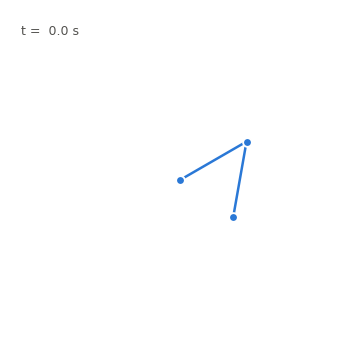
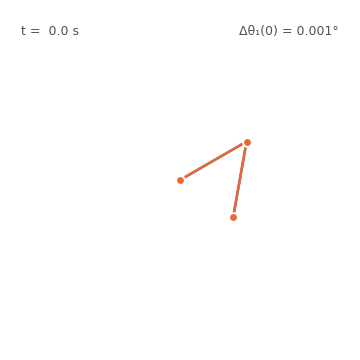
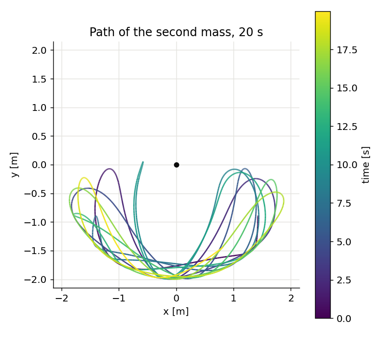
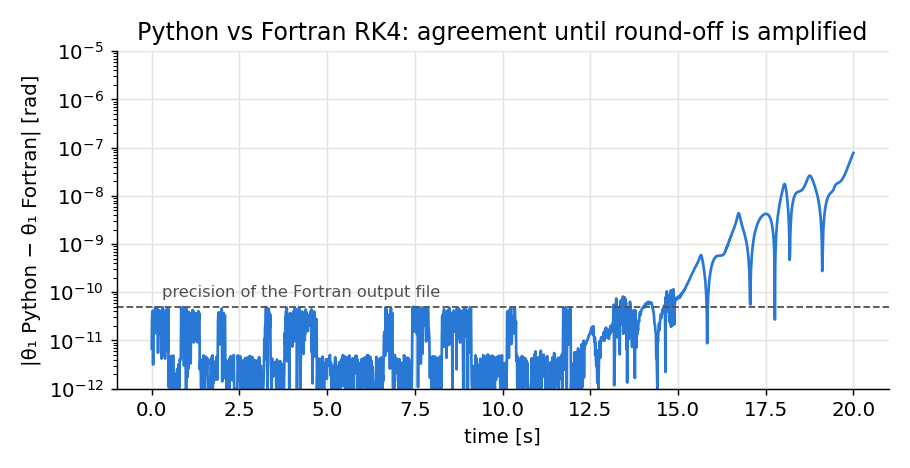

# Double pendulum

Simulation of a planar double pendulum, written as an exercise for learning
Python (NumPy, SciPy, Matplotlib). The equations of motion were derived by
hand from the Lagrangian of two point masses on massless rods. The same
model was also written in Fortran with a fixed-step RK4 integrator, and the
two implementations are compared.

<p align="center">
  
  
</p>

*Right: two pendulums whose initial angle θ₁ differs by 0.001°. They move
together for several seconds and then separate completely.*

## Model

State y = (θ₁, ω₁, θ₂, ω₂), with angles from the downward vertical and Δ = θ₂ − θ₁:

$$\dot\omega_1 = \frac{m_2 L_1 \omega_1^2 \sin\Delta\cos\Delta + m_2 g \sin\theta_2 \cos\Delta + m_2 L_2 \omega_2^2 \sin\Delta - (m_1+m_2) g \sin\theta_1}{(m_1+m_2) L_1 - m_2 L_1 \cos^2\Delta}$$

$$\dot\omega_2 = \frac{-m_2 L_2 \omega_2^2 \sin\Delta\cos\Delta + (m_1+m_2)\left(g \sin\theta_1 \cos\Delta - L_1 \omega_1^2 \sin\Delta - g \sin\theta_2\right)}{(L_2/L_1)\left[(m_1+m_2) L_1 - m_2 L_1 \cos^2\Delta\right]}$$

The Fortran program uses an equivalent form of the same equations (written in
terms of cos 2Δ).

| | |
|---|---|
| [`src/double_pendulum/`](src/double_pendulum/) | equations of motion, SciPy integration (DOP853), fixed-step RK4 |
| [`fortran/double_pendulum.f90`](fortran/double_pendulum.f90) | Fortran RK4 version, two pendulums 0.001° apart, CSV output |
| [`scripts/make_figures.py`](scripts/make_figures.py) | figures and animations |
| [`tests/`](tests/) | Python vs Fortran comparison |



## Python vs Fortran

Both programs integrate the same initial state (θ₁ = 120°, θ₂ = −10°, at rest)
with RK4 and Δt = 0.01 s. The angles agree to the precision of the Fortran
output file (10 significant digits) for about 15 s. After that, the
difference grows exponentially: the motion is chaotic, so round-off
differences between the two programs are amplified, as with the two
pendulums in the animation.



## Running

```bash
pip install -e ".[dev]"
pytest                          # Python vs Fortran comparison
python scripts/make_figures.py  # figures and animations
```

```bash
gfortran -O2 fortran/double_pendulum.f90 -o dp && ./dp   # writes double_pendulum_output.csv
```

`fortran/reference_output.csv` is the output of the Fortran program; the test
uses it when no Fortran compiler is available.
